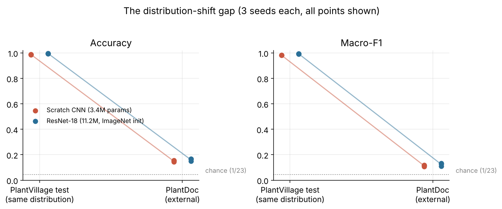
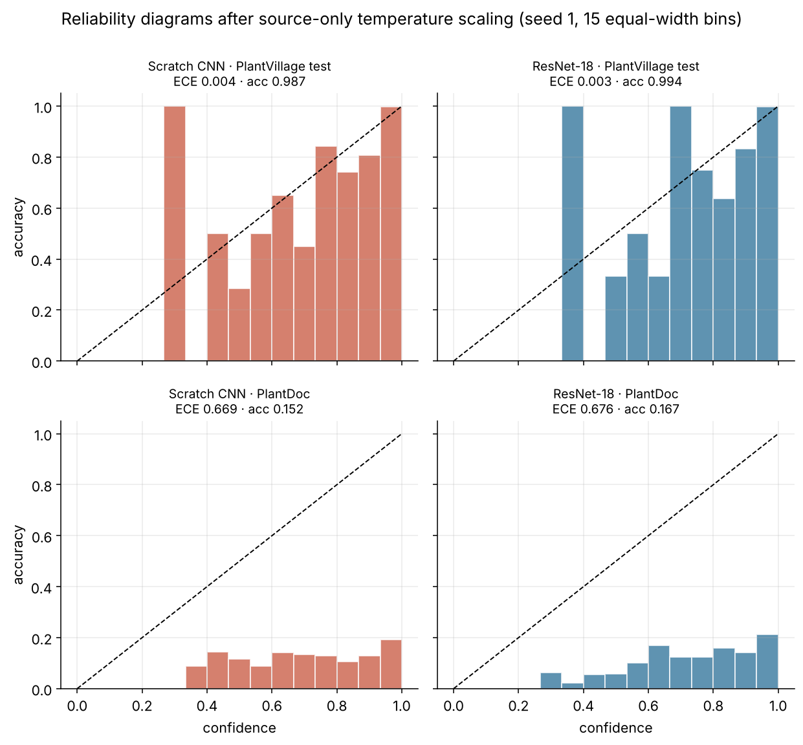
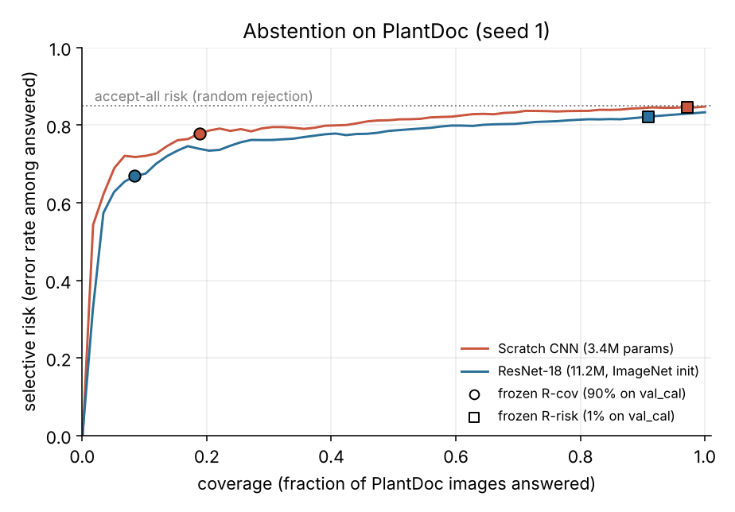

# Plant Disease Classifier Reliability Study

**Do plant-disease classifiers that score ~99% on PlantVillage stay reliable on field-style photos, and can their confidence be trusted to say "I don't know"?**

A pre-registered, leakage-audited comparison of a from-scratch CNN and a fine-tuned ResNet-18, trained on PlantVillage and tested once on PlantDoc, with source-only temperature scaling and confidence-based abstention. Three training seeds per model, cluster-bootstrap intervals, and every decision frozen in git before the external data was touched.

**Read it as a story:** [project page](https://kanishk2705.github.io/plant-disease-reliability/) (problem → design → implementation → results → limitations → next steps, with interactive abstention and calibration plots).



## Headline findings (all numbers are from this repository's runs)

| | PlantVillage test | PlantDoc (external) |
|---|---|---|
| Scratch CNN accuracy / macro-F1 | 0.987 / 0.982 | **0.143–0.154 / 0.107–0.118** |
| ResNet-18 accuracy / macro-F1 | 0.994–0.996 / 0.992–0.995 | **0.149–0.167 / 0.111–0.134** |

Ranges are the three training seeds, shown individually in [`docs/RESULTS_TABLES.md`](docs/RESULTS_TABLES.md). 23 classes, so chance is 4.3%.

1. **Large collapse under distribution shift.** Accuracy falls by about 83 percentage points for both models (95% intervals in every seed roughly 81–86 pp). In-distribution accuracy says almost nothing about field-style images.
2. **ResNet-18 vs scratch CNN: not demonstrated.** ResNet-18's point estimate is higher in all three seeds (macro-F1 +0.004 to +0.019), but the paired 95% interval excludes zero in only one seed, so under the pre-set rule (interval excludes zero *and* every seed agrees) the hypothesis is **not supported**. ImageNet pre-training did not buy robustness here.
3. **Confidence is badly overconfident on PlantDoc.** Mean confidence exceeds accuracy by 0.65–0.74 (external ECE ≈ 0.65–0.74 versus ≈ 0.003–0.005 on the source test). **Temperature scaling fitted on source validation data did not help**: it slightly *raised* external ECE (e.g. CNN 0.58–0.61 → 0.65–0.70), because the fitted temperature was below 1 (0.48–0.85), sharpening the output further. The calibration error here is a distribution-shift problem, not a temperature problem.
4. **Abstention helps a little, and the thresholds do not transfer.** Confidence separates right from wrong answers better than chance on PlantDoc (AUROC 0.59–0.63) but far worse than in-distribution (0.97–0.99). The "90% coverage on validation" rule accepts only 8–19% of PlantDoc images (because source confidence saturates near 1.0), and the "≤1% risk" rule accepts 89–99% of images at an 82–86% error rate. Risk–coverage curves stay close to the accept-everything line.
5. **Per-class and error patterns** are exploratory; see `docs/figures/fig4_per_class_f1.png`.




## What was actually done

| Stage | What | Where |
|---|---|---|
| Protocol | Research questions, hypotheses, metrics, rules fixed before data was used (v1.0, amendments logged) | `docs/research/experimental_protocol.md` |
| Data audit | 54,305 PlantVillage + 2,578 PlantDoc images: duplicates, label conflicts, near-duplicates (DCT pHash), cross-dataset overlap (none exact) | `docs/audit/phase3_audit_report.md` |
| Splits | Leaf-group-aware 70 / 7.5 / 7.5 / 15 split (train / val_sel / val_cal / test), seed 42, zero group or hash overlap across splits and with the external set | `data_manifests/`, `docs/audit/phase4_report.json` |
| Dataset freeze | Class list, mapping, thresholds, manifests, transform, hashed and committed before training | `configs/frozen/dataset_decisions_v1.json` |
| Training | 23 classes; AdamW; fp16; checkpoint chosen by lowest val_sel NLL; learning rate chosen on val_sel only (3 values per model); seeds 1, 2, 3 | `scripts/colab_train.py` |
| Calibration | One temperature per run fitted on val_cal only; R-cov (90%) and R-risk (1%) thresholds from val_cal | `scripts/calibrate_runs.py` |
| Run freeze | Temperature, thresholds, checkpoint SHA-256 and code commit committed per run **before any PlantDoc inference**; the evaluator refuses to run if verification fails | `configs/frozen/final_*.json`, `src/plantrel/freeze.py` |
| External evaluation | One pass on PlantDoc, 10,000-resample cluster bootstrap (clusters = leaf group / duplicate group), gap and paired intervals | `scripts/final_eval.py`, `results/results.json` |

The dataset files are verified against SHA-256 manifests (35,410 files) on every fresh runtime. The test-suite (229 tests) covers metrics, bootstrap, checkpointing/resume, the freeze verifier and the training loop.

## Method notes that matter for interpretation

- **Source:** PlantVillage colour images, grouped by leaf (`leaf_id`) so the same leaf never appears in two splits; images without a leaf mapping get fallback groups; same-class near-duplicates (pHash ≤ 2) are merged.
- **External:** PlantDoc "cropped" release (whole images), de-duplicated (conflicting-label clusters removed), mapped to PlantVillage classes. Primary set: **23 classes, 1,993 images**; every class has at least 53.
- **Evaluation transform:** whole image resized to 224×224, no crop, identical for both models and datasets.
- **Metrics:** macro-F1 over a frozen class list; ECE with 15 equal-width bins (primary; equal-mass ECE is also stored in `results/results.json`); multiclass Brier as sum over classes (range 0–2); NLL; selective risk and coverage with counts; AURC; AUROC for error detection. Three seeds are reported individually, never averaged into an ensemble.

## Limitations (please read)

- **One dataset pair, one split seed.** Nothing here shows the pattern holds for other crops, datasets or architectures.
- **Class mapping is provisional.** The PlantVillage→PlantDoc mapping was proposed from general pathology knowledge and was not validated by a plant pathologist. Some PlantDoc classes ("Apple leaf", "Peach leaf") contain fruit and stock photos, and web-scraped labels are noisy; part of the 85% error is label and domain noise, not model failure alone.
- **Hyperparameter grids are small and sit at an edge** (CNN best at the smallest learning rate tried, ResNet-18 at the largest). Better tuning could shift absolute numbers, but not plausibly close an 83-point gap. Both models were tuned with the same budget on source validation data only.
- **Temperature below 1** (sharpening) was fitted on clean validation images while training used augmentation; the cause is a hypothesis, not tested here.
- **Licence:** code is MIT (see `LICENSE`). PlantDoc is CC BY 4.0. The PlantVillage licence could not be confirmed from primary sources (repository, mirror and portal disagree or were unreachable); datasets are not redistributed here, only hashes and file lists.
- **Not comparable to other papers as-is:** a related 2026 study (Xiang et al., *Frontiers in Plant Science*) reports a different class set, model and evaluation transform; this repository does not claim to reproduce or beat its numbers.
- **Not an agricultural advice tool.** Do not use it to decide treatment.
- **Code fix after freeze (transparent):** the first external run crashed on a JSON-serialisation bug before any metric was seen; a fix was committed and the run freezes re-issued with identical temperatures, thresholds and checkpoint hashes (amendment A3.1 in `docs/PROJECT_RECORD.md`).
- **No live inference demo is deployed.** The results explorer in `docs/index.html` is static; a hosted model demo is future work.

## Next steps

- Pathologist review of the class mapping.
- A small labelled field sample, kept separate from the evaluation set, to test target-domain calibration.
- Domain-robust training and more architectures and datasets.
- A small Streamlit demo and a walkthrough video.

## Reproduce

```bash
git clone https://github.com/kanishk2705/plant-disease-reliability && cd plant-disease-reliability
pip install -e ".[torch]"            # or use requirements-colab.txt on Colab
python scripts/colab_prepare.py --work work        # clones datasets at pinned revisions, verifies every file hash, builds caches
python scripts/colab_train.py dev   --work work --max-epochs 15 --patience 4
python scripts/colab_train.py final --work work --max-epochs 15 --patience 4 --lr cnn=0.0005 resnet18=0.001
python scripts/calibrate_runs.py --work work
# issue run freezes (scripts/make_run_freeze.py), commit them, then:
python scripts/final_eval.py --run-id final_cnn_s1 --work work --repo-root .
python report/make_tables.py && python report/make_figures.py
```

Training used a Colab T4 (Python 3.13, PyTorch 2.11, torchvision 0.26) at about 17 minutes per run. GPU results are not bit-exact across hardware.

## Repository map

`src/plantrel` library · `scripts/` pipeline entry points · `configs/frozen/` hashed freezes · `data_manifests/` split manifests · `results/results.json` aggregated results · `docs/figures` plots · `docs/research` protocol and literature review · `docs/audit` data audit · `tests/` 229 tests · `report/` table and figure generation (outside the frozen code paths).

## Citing

See `CITATION.cff`. Datasets: PlantVillage (Hughes & Salathé, 2015; Mohanty et al., 2016) and PlantDoc (Singh et al., 2020).
